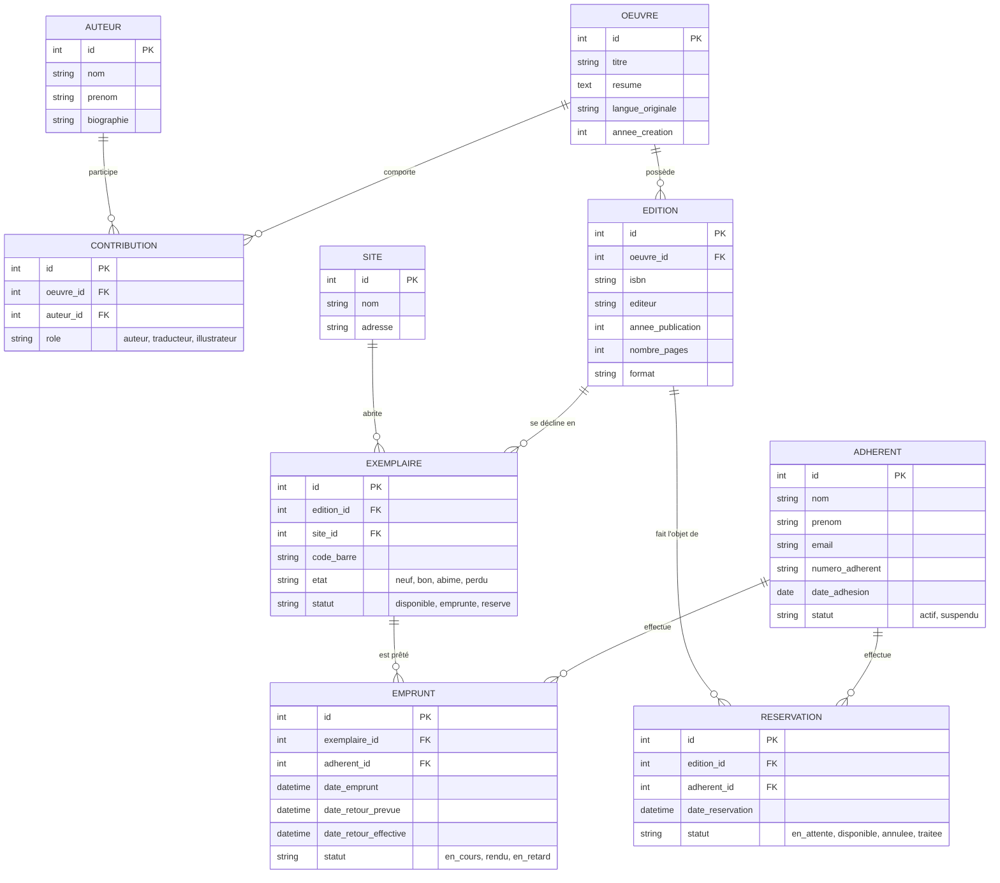

# Modèle de données

## Explications du modèle

Ce modèle de données repose sur une séparation claire des responsabilités :
- **Séparation Œuvre / Édition / Exemplaire** : L'œuvre représente le contenu intellectuel abstrait (l'histoire, le texte original). L'édition représente la publication commerciale et éditoriale (ISBN, éditeur, date, traduction). L'exemplaire représente l'objet physique matériel, localisé dans un site précis du réseau, identifié par un code-barres et caractérisé par son état d'usure.
- **Gestion des contributeurs** : La table intermédiaire `Contribution` permet de rattacher plusieurs personnes à une œuvre en précisant leur rôle exact (auteur principal, traducteur, illustrateur, etc.).
- **Réservations vs Emprunts** : Les réservations ciblent une édition (l'usager réserve le contenu/livre souhaité), alors que l'emprunt est directement rattaché à un exemplaire physique précis.
- **Réseau multi-sites** : Chaque exemplaire est affecté à un `Site` du réseau de médiathèques, permettant la gestion des transferts et de la disponibilité par site.
