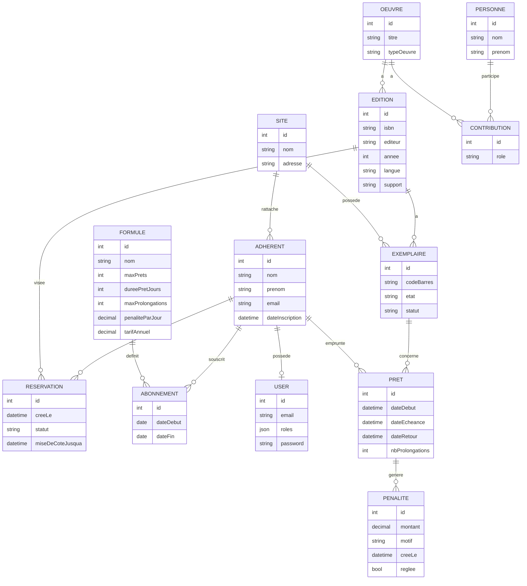

# Modèle de données

Sujet 4 : réseau de médiathèques. Dernière mise à jour : 14/11/2026.

## Diagramme

## Choix de modélisation

- **Œuvre, Édition, Exemplaire** : trois niveaux distincts. L'œuvre est le contenu intellectuel, l'édition est une publication précise (ISBN, éditeur, année, langue, support), l'exemplaire est l'objet physique prêtable, avec son code-barres, son état et son site.
- **Contribution** : table de liaison entre Œuvre et Personne, avec un rôle (auteur, traducteur, illustrateur). Elle gère les auteurs multiples sans colonne dédiée.
- **Formule** : stockée en base. Limites de prêts, durée, prolongations et pénalité journalière sont paramétrables, rien n'est codé en dur.
- **Abonnement** : historique des souscriptions d'un adhérent (dates de début et de fin). La formule applicable à une date donnée est calculée par `Adherent::getFormuleActive()`.
- **Réservation** : liée à une **édition**, pas à un exemplaire. L'adhérent veut un titre, peu importe l'exemplaire. L'ordre de la file est donné par `creeLe`.
- **Prêt** : `dateRetour` à `null` signifie « en cours ». Le nombre de prolongations est suivi sur le prêt.
- **Pénalité** : rattachée au prêt, avec un motif (retard, perdu, abîmé) et un état de règlement.
- **User** : gère l'authentification (`email` unique, `roles`, mot de passe haché). Lié en OneToOne nullable à `Adherent` (un bibliothécaire n'est pas forcément adhérent ; un adhérent a un compte utilisateur pour son espace personnel).
- **Montants** : `decimal`, jamais de `float`.
